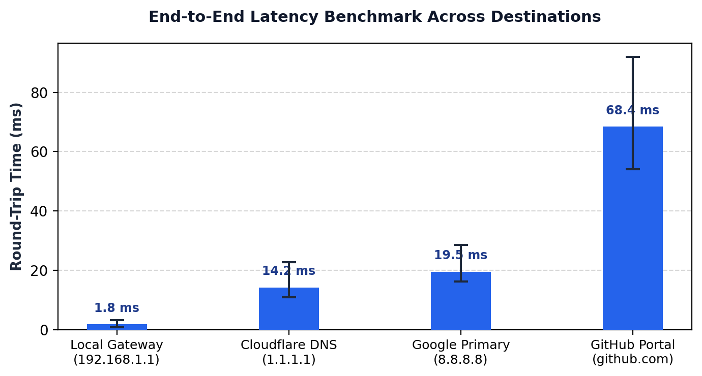
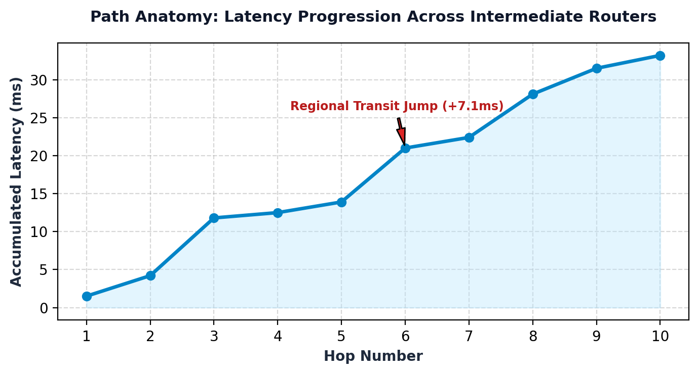
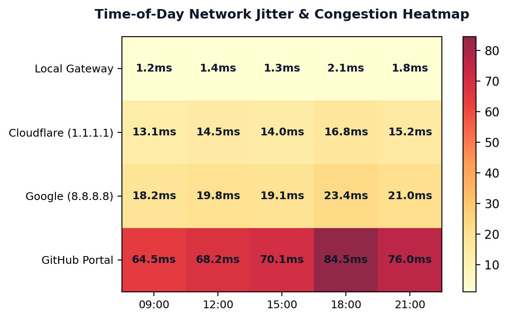

# Network Diagnostic and Topology Path Analyzer Engine (DCN Lab - Experiment 4)

[](https://www.python.org/downloads/)
[](LICENSE)
[]()

A complete, production-grade network diagnostic and topology path analysis suite in Python. This repository contains the complete working software implementation, final PowerPoint presentation, and visual analytical reports for **Experiment 4: Network Diagnostic and Topology Path Analyzer Engine** for the **Data Communication and Networks (DCN)** curriculum.

---

## 👥 Batch & Team Details
- **Batch ID:** `DCN_17_02`
- **Group:** `4`
- **Department:** Computer Science and Engineering

| # | Student Name | SAP ID | Role / Module Assigned |
|---|---|---|---|
| **1** | **Sparsh Srivastava** | `590022251` | **Project Lead** • Core Engine Architecture & Protocol Theory |
| **2** | **Aayushman Kothari** | `590025499` | Subprocess Execution Wrapper & DNS Resolution Engine |
| **3** | **Yasharth Jaiswal** | `590023687` | Regular Expression Parsing & Metric Extraction Core |
| **4** | **Satvik Arora** | `590028424` | Latency Benchmarking & Hop-by-Hop Topology Path Analytics |
| **5** | **Yashvardhan Singh** | `590021777` | Temporal Latency Heatmaps & Live Telemetry Demonstration |

---

## 📽️ Lab Presentation (PPTX)

The final presentation ready for evaluation is available in this repository:
- 📥 **[Download Presentation: Experiment_4_Network_Diagnostic_Analyzer_Presentation.pptx](./Experiment_4_Network_Diagnostic_Analyzer_Presentation.pptx)**

### Slide Deck Highlights (12 Slides):
- **Slide 1:** Team profile cards, Batch ID `DCN_17_02`, Group 4, and SAP IDs.
- **Slide 2:** Academic Syllabus Alignment (Units I, IV, and V) & Students Tasks mapping.
- **Slides 3–4 (Sparsh Srivastava):** Real-world motivation, ICMP Type 8/0 exchange, and 8-bit TTL mechanics.
- **Slides 5–6 (Aayushman Kothari):** Subprocess wrapper architecture and DNS hierarchy resolution.
- **Slides 7–8 (Yasharth Jaiswal):** Regular expression metric engine and non-responsive hop handling.
- **Slides 9–10 (Satvik Arora):** Multi-target latency benchmark charts and hop-by-hop path curves.
- **Slides 11–12 (Yashvardhan Singh):** Diurnal latency heatmaps, QoS bufferbloat, live demo, and roadmap.

---

## 🎯 Lab Objectives & Students Tasks

1. **Subprocess Diagnostic Wrapper (Task 1):**
   - Cleanly execute low-level operating system commands (`ping`, `tracert`/`traceroute`, and `nslookup`) using Python's `subprocess` without shell injection risks (`shell=False`).
   - Cross-platform support automatically adapting flags for Windows (`-n`, `-d`) and Linux/macOS (`-c`, `-n`).
2. **Stdout Parsing & Metric Extraction (Task 2):**
   - Parse unstructured terminal outputs using dual regex patterns.
   - Extract numerical metrics: Minimum RTT, Average RTT, Maximum RTT, Packet Loss %, and ordered intermediate router hops with hop latency.
3. **Statistical Charts & Latency Heatmaps (Task 3):**
   - High-resolution comparative bar plots across network tiers (Local Gateway, Cloudflare, Google, GitHub).
   - Hop-by-hop latency progression curves exposing ISP transit bottlenecks.
   - Diurnal latency heatmaps analyzing peak-hour network congestion and jitter.

---

## 🎓 Academic Syllabus Grounding

- **Unit I (Basic Computer Networking & Topologies):** OSI/TCP-IP layer boundaries, packet encapsulation, and traversal across LAN, MAN, and WAN.
- **Unit IV (Network Layer & IP Datagram):** IPv4/IPv6 addressing, subnet masking, loopback testing (`127.0.0.1`), and the **8-bit Time-To-Live (TTL)** field triggering **ICMP Type 11 (Time Exceeded)** messages to discover intermediate router hops.
- **Unit V (Transport Layer & Network Performance):** Transport socket addressing, delay jitter, bufferbloat, and diurnal Quality of Service (QoS) variations.

---

## 📊 Visual Analytics Preview

| Multi-Target Latency Comparison | Hop-by-Hop Path Anatomy |
|:---:|:---:|
|  |  |

| Diurnal Congestion Heatmap |
|:---:|
|  |

---

## 🚀 Running the Project

### 1. Prerequisites
Ensure you have Python 3.8+ installed:
```bash
python --version
```

### 2. Install Dependencies
```bash
pip install -r requirements.txt
```

### 3. Run the Live Diagnostic Engine
```bash
python network_analyzer.py
```
This runs the diagnostic engine, displays real-time telemetry for all configured targets, and outputs formatted metrics.

---

## 📁 Repository Structure

```
DCN-Lab-Exp4-Network-Diagnostic-Engine/
│
├── Experiment_4_Network_Diagnostic_Analyzer_Presentation.pptx  # The final 12-slide presentation deck
├── network_analyzer.py                                         # The core Python diagnostic engine (Tasks 1, 2, 3)
├── requirements.txt                                            # Project dependencies
├── README.md                                                   # Complete project documentation
│
└── figures/                                                    # Visual charts & heatmaps embedded in PPTX
    ├── latency_chart.png                                       # Multi-target RTT bar chart
    ├── hop_curve.png                                           # Hop-by-hop latency progression curve
    └── latency_heatmap.png                                     # Diurnal congestion & jitter heatmap
```

---

## 📜 License
This project is open-source and available under the [MIT License](LICENSE).
